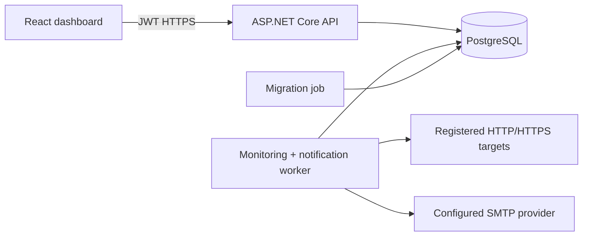

# Sentinel

Sentinel is a production-style uptime monitoring and incident management platform built to demonstrate practical .NET backend engineering: secure monitor registration, SSRF-safe HTTP checks, PostgreSQL-backed scheduling, incident transitions, durable notifications, and a small operational dashboard.

## Stack

- .NET 10, ASP.NET Core Web API, EF Core, PostgreSQL
- ASP.NET Core Identity with JWT authentication
- Independent `BackgroundService` monitoring and notification workers
- React, Vite, and responsive dark dashboard
- xUnit, Testcontainers, Docker Compose, GitHub Actions

## Architecture



Sentinel is a modular monolith with an independently deployable worker. PostgreSQL leases coordinate work across multiple worker instances; Redis, RabbitMQ, Kubernetes, and microservices are intentionally out of scope.

## Run locally with Docker Compose

Copy the example environment file and replace the values:

```bash
cp .env.example .env
docker compose up --build
```

The Compose stack contains PostgreSQL, a one-shot migration job, the API, the worker, and the React dashboard:

- Dashboard: `http://localhost:3000`
- API: `http://localhost:8080`
- API liveness: `http://localhost:8080/health`
- API readiness: `http://localhost:8080/health/ready`

PostgreSQL is bound to localhost only and persists data in a named Docker volume. The migration job runs before API and worker startup. Production HTTPS should terminate at a reverse proxy or managed ingress; internal container traffic uses the private Compose network.

For local frontend development:

```bash
cd web
npm install
npm run dev
```

Set `VITE_API_BASE_URL` if the API is not at `http://localhost:8080`.

For a safe local SMTP verification, start Mailpit without sending messages to
real recipients:

```bash
EMAIL_HOST=mailpit EMAIL_PORT=1025 EMAIL_FROM=alerts@sentinel.local \
  docker compose --profile email-test up --build
```

Open `http://localhost:8025` to inspect captured messages. Mailpit is an
optional local profile and is not a production email provider.

## Run backend tests

The pinned SDK is in `global.json`. Docker Desktop must be running for PostgreSQL integration tests.

```bash
dotnet restore Sentinel.slnx
dotnet build Sentinel.slnx
dotnet test Sentinel.slnx
```

The current suite includes unit tests for domain, SSRF, workers, incidents, and outbox behavior, plus PostgreSQL integration tests for ownership, leases, transitions, retries, migrations, and API contracts.

## Production deployment shape

Build and publish the API and worker images, run `Dockerfile.migrations` as a one-shot deployment task, then start the API and worker with `Database__ApplyMigrations=false`. Secrets are supplied through the deployment secret store or environment variables:

```text
ConnectionStrings__DefaultConnection
Jwt__Issuer
Jwt__Audience
Jwt__SigningKey
Email__Host
Email__Username
Email__Password
Email__From
```

Never commit `.env`, connection strings, JWT signing keys, or SMTP credentials.

## Demonstration walkthrough

1. Register an account in the dashboard.
2. Add a reachable public HTTPS health endpoint.
3. Confirm successful check history and uptime statistics.
4. Point a monitor at a controlled public test endpoint and produce three failed checks.
5. Verify one open incident and one `IncidentOpened` outbox event.
6. Restore the endpoint and allow two successful checks.
7. Verify the incident is recovered and one `IncidentRecovered` event is queued.

The production URL policy remains active during demonstrations; use a controlled public endpoint rather than weakening SSRF protections or targeting private infrastructure.

## Tradeoffs and limitations

- Monitoring and notifications are at-least-once. A crash after an email provider accepts a message can produce duplicate delivery.
- SMTP is the initial provider; provider-specific idempotency adapters and dead-letter operations are future improvements.
- Incident history and checks use bounded windows to protect database load.
- The current retention policy is 90 days for check results, incident transitions, and notification records; a scheduled cleanup job is planned before long-term production use.
- HTTPS certificate management belongs at the deployment edge rather than inside the application containers.

See [docs/API_CONTRACTS.md](docs/API_CONTRACTS.md), [docs/ARCHITECTURE.md](docs/ARCHITECTURE.md), [docs/SECURITY_MODEL.md](docs/SECURITY_MODEL.md), and [docs/WEEK3_INCIDENTS_NOTIFICATIONS.md](docs/WEEK3_INCIDENTS_NOTIFICATIONS.md).
